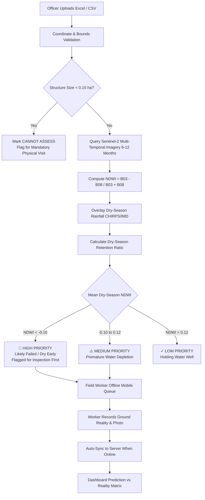

# JalSakshya (जल साक्ष्य)
### Sentinel-2 Satellite Multi-Temporal Telemetry & Offline-First Ground Verification for Village Water Structures


---

## 1. Problem Statement
The Government and rural development programs (e.g. MGNREGA, Jal Jeevan Mission, Amrit Sarovar) construct thousands of village ponds, check dams, and percolation tanks each year for rainwater harvesting and groundwater replenishment. 

**The Core Challenge:**
- After construction, almost no one checks whether structures still retain water during the critical peak dry summer months (March – May).
- Block and district officers have limited field inspection capacity and cannot physically visit hundreds or thousands of scattered rural sites.
- Structures that breached embankments, suffered severe siltation, or dried prematurely remain unknown until local drought crises emerge.

## 2. The JalSakshya Solution
**JalSakshya** combines free open satellite imagery (Sentinel-2 Multi-Spectral Instrument) with precipitation archives (CHIRPS / IMD / Open-Meteo) to automatically rank water structures from *"probably fine"* to *"needs inspection first"*.

1. **Satellite Analysis Engine:** Ingests Sentinel-2 B03 (Green) and B08 (NIR) multi-temporal bands over the preceding 6–12 months, calculating the Normalized Difference Water Index (NDWI):
   $$\text{NDWI} = \frac{\text{B03 (Green)} - \text{B08 (NIR)}}{\text{B03 (Green)} + \text{B08 (NIR)}}$$
2. **Precipitation Anomaly Cross-Referencing:** Overlays local rainfall trends to distinguish between drought vs structural failure (e.g., structures that received 600mm monsoon rain but dried up immediately in November).
3. **Four Triage Priority Categories:**
   - 🚨 **High Priority (Likely Empty / Failed):** Water disappeared early in the dry season; mean dry-season NDWI < 0.0 despite rainfall. **Needs physical inspection first.**
   - ⚠️ **Medium Priority (Declining / Receding):** Water volume depleting prematurely by February/March. Embankment or de-siltation check required.
   - ✓ **Low Priority (Functioning Well):** High water presence (NDWI > 0.15) sustained well into late dry summer (April–May).
   - ⚠️ **Cannot Assess (< 0.15 ha):** Structures smaller than ~1,500 m² cannot be reliably assessed by 10m Sentinel-2 pixels due to edge contamination. Marked honestly for mandatory physical visit.
4. **Offline-First Field Worker Mobile App:** Field workers (GRS, Gram Sevaks) receive the ranked priority queue on low-end Android phones. They record ground-truth reality (Holding Water, Partially Filled, Dry, Damaged, Not Found), take photo proof, and record GPS distance—even with zero cellular reception. When network is restored, data auto-syncs in batches.
5. **Dashboard Comparison View:** Aggregates a confusion matrix (True Positives, False Positives, True Negatives, False Negatives) and compares satellite predictions against real ground evidence.

---

## 3. Project Structure

```
JalSakshya/
├── backend/
│   ├── app/
│   │   ├── api/
│   │   │   ├── auth.py              # Role-based access (Admin, Officer, Field Worker)
│   │   │   ├── structures.py        # CSV/Excel upload, ranked listing, CRUD, templates
│   │   │   ├── satellite.py         # Multi-temporal NDWI telemetry, SVG snapshot gallery
│   │   │   ├── inspections.py       # Offline batch sync, photo uploads, GPS distance
│   │   │   └── analytics.py         # Prediction vs reality metrics, confusion matrix
│   │   ├── core/
│   │   │   └── config.py            # Resolution limit (0.15 ha), DB URL, India bounds
│   │   ├── db/
│   │   │   └── session.py           # SQLAlchemy session engine (PostgreSQL/PostGIS or SQLite)
│   │   ├── models/                  # Database models
│   │   │   ├── structure.py         # Water structure entity & priority enums
│   │   │   ├── satellite.py         # Sentinel-2 observations, NDWI, rainfall, snapshot URLs
│   │   │   ├── inspection.py        # Ground truth field verifications & agreement flags
│   │   │   └── user.py              # User roles
│   │   ├── schemas/                 # Pydantic validation schemas
│   │   ├── services/
│   │   │   ├── coordinate_validator.py  # Geographic coordinate bounds & Haversine distance
│   │   │   ├── excel_parser.py          # Flexible Excel (.xlsx, .xls) & CSV parser
│   │   │   ├── weather_service.py       # Rainfall time series overlay (CHIRPS/IMD/Open-Meteo)
│   │   │   ├── satellite_engine.py      # Sentinel-2 spectral client & False-Color SVG generator
│   │   │   ├── ranking_service.py       # Multi-factor explainable priority ranking algorithm
│   │   │   └── seed_data.py             # Pre-seeded drought-prone structures (Datia & Ahmednagar)
│   │   ├── main.py                  # FastAPI application entry point
│   │   └── requirements.txt         # Python dependencies
│   ├── uploads/                     # Storage for field photos and satellite SVGs
│   └── Dockerfile
├── frontend/
│   ├── src/
│   │   ├── components/
│   │   │   ├── Navbar.jsx               # GIS Command Header & Offline Mode switch
│   │   │   ├── StatsOverview.jsx        # Summary telemetry cards with priority filters
│   │   │   ├── StructureMap.jsx         # Leaflet interactive map with custom glowing pins
│   │   │   ├── StructureList.jsx        # Filterable ranked triage table with badges
│   │   │   ├── StructureDetailModal.jsx # Multi-temporal NDWI & Rainfall chart + snapshot gallery
│   │   │   ├── UploadModal.jsx          # Drag & drop upload with validation & template downloads
│   │   │   ├── AccuracyComparison.jsx   # Confusion matrix, accuracy stats & disclaimer
│   │   │   └── FieldWorkerApp.jsx       # Offline-first mobile worker simulator with queue & sync
│   │   ├── services/
│   │   │   ├── api.js                   # Backend HTTP API client
│   │   │   └── offlineStorage.js        # Browser localStorage / IndexedDB offline queue
│   │   ├── styles/
│   │   │   └── index.css                # Polished GIS dark/light telemetry styling
│   │   ├── App.jsx                      # Main React component
│   │   └── main.jsx
│   ├── package.json
│   ├── vite.config.js
│   └── Dockerfile
├── mobile/                              # Native Flutter / SQLite offline architecture
│   ├── lib/
│   │   ├── services/
│   │   │   ├── offline_database.dart    # SQLite schema (cached_structures & offline_inspections)
│   │   │   └── sync_manager.dart        # Background connectivity listener & batch sync
│   │   ├── screens/
│   │   │   ├── assigned_structures_screen.dart # Mobile ranked list for field workers
│   │   │   └── inspection_form_screen.dart     # Offline status & camera verification form
│   │   └── main.dart
│   ├── pubspec.yaml
│   └── README.md
├── templates/
│   ├── sample_structures_template.xlsx  # Downloadable Excel template
│   └── sample_structures.csv            # Downloadable CSV template
├── tests/
│   ├── run_tests.py                     # Standard library test runner
│   └── test_backend.py                  # Comprehensive unit tests (coordinates, NDWI, ranking)
├── docker-compose.yml
└── README.md
```

---

## 4. Database Schema (PostgreSQL + PostGIS / SQLite)

### `structures`
- `id` (VARCHAR PK): e.g. `STR-MP-DAT-001`
- `name` (VARCHAR): Structure name
- `structure_type` (ENUM): `pond`, `check_dam`, `percolation_tank`, `amrit_sarovar`, `other`
- `latitude`, `longitude` (FLOAT / GEOMETRY Point): Geographic coordinates (EPSG:4326)
- `approximate_size_ha` (FLOAT): Area in hectares
- `construction_year` (INTEGER)
- `district`, `block`, `village`, `state` (VARCHAR): Administrative location
- `priority` (ENUM): `HIGH`, `MEDIUM`, `LOW`, `CANNOT_ASSESS`
- `water_retention_score` (FLOAT): 0 to 100% dry season retention ratio
- `assessment_reason` (TEXT): Transparent human-readable explanation
- `mean_dry_season_ndwi` (FLOAT)
- `cumulative_rainfall_mm` (FLOAT)

### `satellite_observations`
- `id` (INTEGER PK AUTOINCREMENT)
- `structure_id` (VARCHAR FK -> structures.id)
- `observation_date` (DATE): Acquisition date
- `ndwi_value` (FLOAT): Green vs NIR spectral index
- `mndwi_value` (FLOAT): Modified NDWI with SWIR band
- `water_detected` (BOOLEAN): NDWI > 0.05
- `water_coverage_pct` (FLOAT): Percentage of water area inside bounding polygon
- `recent_rainfall_mm` (FLOAT): Preceding 14-day rainfall sum
- `snapshot_url` (VARCHAR): Static SVG/PNG Sentinel-2 false-color NIR snapshot card
- `is_key_snapshot` (BOOLEAN): Marked for the 3–4 key dry-season snapshots

### `field_inspections`
- `id` (VARCHAR PK): Client offline UUID or server ID
- `structure_id` (VARCHAR FK -> structures.id)
- `inspector_id`, `inspector_name` (VARCHAR)
- `inspection_date` (DATETIME)
- `actual_status` (ENUM): `HOLDING_WATER`, `PARTIALLY_FILLED`, `DRY`, `DAMAGED`, `NOT_FOUND`
- `water_depth_meters` (FLOAT)
- `bund_condition` (ENUM): `INTACT`, `PARTIAL_EROSION`, `BREACHED`
- `siltation_level` (ENUM): `LOW`, `MODERATE`, `SEVERE`
- `photo_url` (VARCHAR): Uploaded verification image
- `worker_latitude`, `worker_longitude` (FLOAT)
- `gps_distance_to_structure_m` (FLOAT): Haversine distance from recorded coordinates
- `agrees_with_satellite` (BOOLEAN): Validation flag
- `is_offline_synced` (BOOLEAN)

---

## 5. Satellite Analysis Pipeline & Ranking Logic



### The Spatial Resolution Boundary
- Sentinel-2 pixel size is **10m × 10m (100 m² = 0.01 hectare)**.
- Water detection algorithms require **at least 10–15 pure pixels** to avoid mixed-edge contamination with surrounding soil/vegetation.
- Therefore, structures with an approximate area of **< 0.15 hectare (~1,500 m²)** are explicitly categorized as **`CANNOT_ASSESS`** with a clear explanation: *"Structure too small for Sentinel-2 10m resolution. Ground physical inspection required."*

---

## 6. How to Run Locally

### Prerequisites
- Python 3.11+
- Node.js 18+ and npm

### Step 1: Start Backend (FastAPI)
```bash
# Navigate to backend directory
cd backend

# Run the FastAPI development server
# (Uses SQLite by default for zero-config instant startup and auto-seeds initial data)
py -3.11 -m uvicorn app.main:app --host 127.0.0.1 --port 8000 --reload
```
API Documentation will be available at:
- **Interactive Swagger Docs**: `http://127.0.0.1:8000/docs`
- **ReDoc**: `http://127.0.0.1:8000/redoc`

### Step 2: Start Frontend (React + Vite)
In a new terminal:
```bash
# Navigate to frontend directory
cd frontend

# Start the Vite development server
npm run dev
```
Open your browser at **`http://localhost:3000`**.

### Step 3: Run Automated Unit Tests
```bash
py -3.11 tests/run_tests.py
```
Validates coordinate bounding checks, Haversine proximity formulas, NDWI spectral math, resolution limits (<0.15 ha), and CSV/Excel parsing.

---

## 7. API Endpoints Reference

| Method | Endpoint | Description |
|---|---|---|
| `GET` | `/api/v1/structures` | Filterable list of structures (by priority, type, district, search) |
| `POST` | `/api/v1/structures/upload` | Upload Excel/CSV file with instant coordinate validation & satellite analysis |
| `GET` | `/api/v1/structures/template` | Download sample Excel (`.xlsx`) or CSV template |
| `GET` | `/api/v1/structures/{id}` | Single structure details with latest field inspection status |
| `POST` | `/api/v1/structures/{id}/reanalyze` | Re-run Sentinel-2 spectral calculation and priority ranking on demand |
| `GET` | `/api/v1/satellite/structure/{id}` | Multi-temporal NDWI time-series, rainfall overlay, and snapshot gallery |
| `GET` | `/api/v1/satellite/snapshots/{filename}` | Serve Sentinel-2 False-Color NIR SVG snapshot cards |
| `POST` | `/api/v1/inspections` | Submit single ground-truth inspection |
| `POST` | `/api/v1/inspections/sync-batch` | **Offline-first batch sync** endpoint for mobile queue |
| `POST` | `/api/v1/inspections/upload-photo` | Field verification camera photo upload |
| `GET` | `/api/v1/analytics/comparison` | **Prediction vs Reality Metrics**, Confusion Matrix & Ground Truth audit log |

---

## 8. Sample Excel / CSV Format

Downloadable templates are generated directly in the `templates/` folder and accessible in the Web UI:
- `templates/sample_structures_template.xlsx`
- `templates/sample_structures.csv`

Columns:
```csv
Structure ID,Name,Type,Latitude,Longitude,Size (ha),Construction Year,District,Block,Village
STR-MP-DAT-010,Kalyanpur Check Dam,check_dam,26.155000,78.765000,0.85,2021,Datia,Seondha,Kalyanpur
STR-MP-DAT-011,Rampur Gaon Talab,pond,26.128000,78.810000,1.40,2022,Datia,Seondha,Rampur
STR-MP-DAT-012,Chhoti Baori (Micro Pond),pond,26.141000,78.790000,0.08,2023,Datia,Seondha,Kakarua
```

---

## 9. Honesty & Governance Safeguards
1. **Decision Support, Not Executive Action:** The system prioritizes and triages structures to optimize scarce field officer visits. Official repair and budget allocation decisions remain exclusively with human engineers.
2. **Resolution Honesty:** Micro-ponds smaller than 0.15 ha are never artificially assigned confident water metrics; they are transparently marked `CANNOT_ASSESS`.
3. **Ground-Truth Calibration:** Accuracy metrics (confusion matrix, precision, recall) are marked provisional until statistically significant field inspections are recorded.

---

## 10. License

This project is licensed under the [MIT License](LICENSE) - see the [LICENSE](LICENSE) file for full details.

